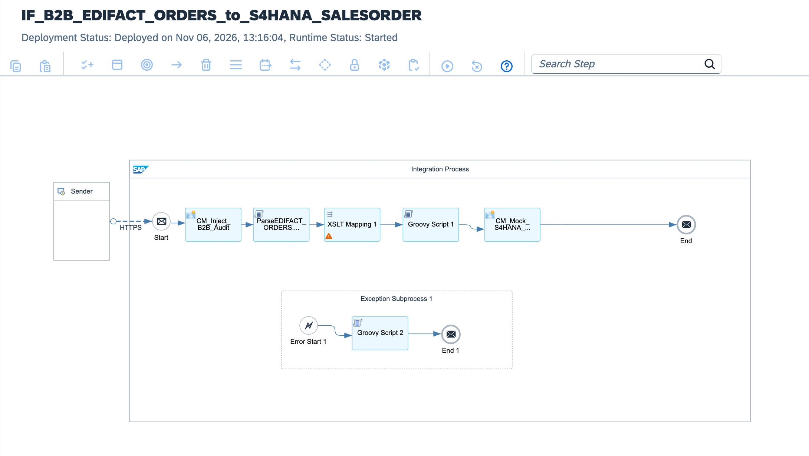

# Enterprise B2B Order-to-Cash Modernization: UN/EDIFACT D.01B ORDERS to S/4HANA ORDERS05 via Trading Partner Management (TPM) & MAG

[](https://www.sap.com)
[-darkgreen?style=for-the-badge)](https://www.sap.com)
[-blue?style=for-the-badge)](https://www.sap.com)
[](https://unece.org)
[](https://tools.ietf.org/html/rfc4130)
[](https://www.sap.com)

---

## Executive Summary

Global retail, automotive, and high-tech supply chains rely on inbound electronic Purchase Orders (**UN/EDIFACT D.01B ORDERS**) transmitted by trading partners and distributors. Traditional B2B architectures relied on point-to-point EDI converters, hardcoded partner mappings, and fragmented communication channels that generated high maintenance overhead and caused catastrophic order rejections during seasonal traffic spikes.

This architecture delivers a **Production-Grade B2B Order-to-Cash (OTC) Engine**:
1. **Trading Partner Management (TPM) Agreement Orchestration:** Replaces static channel bindings with centralized SAP TPM agreements, resolving partner identities, security certificates, and business SLA profiles dynamically at runtime.
2. **AI-Assisted Mapping Guidelines (MAG):** Implements canonical structural transformations generated via SAP Integration Advisor, mapping UN/EDIFACT D.01B semantics directly to standard SAP S/4HANA Sales Order IDocs (`ORDERS05`) without custom ABAP conversion routines.
3. **Cryptographic Non-Repudiation (AS2):** Enforces mutual certificate exchange and generates cryptographically signed synchronous Message Disposition Notifications (MDN) with SHA-256 MIC verification.
4. **Resilient Failover & SFTP Dead-Letter Queue (DLQ):** Quarantines malformed EDI structures or backend timeouts into an automated SFTP audit repository, ensuring zero transaction loss and immediate operations triage.

---

## Architecture Overview



### High-Level Topology

```text
[Global Trading Partner / Retailer (GLN: 4012345000001)]
          │
          │ UN/EDIFACT D.01B ORDERS (AS2 / HTTPS)
          │ Synchronous Signed MDN (SHA-256 MIC)
          ▼
[SAP Integration Suite: IF_B2B_EDIFACT_ORDERS_to_S4HANA_ORDERS05]
  │
  ├── 1. Context & Security Initialization (CM_Init_B2B_Context):
  │    └─ Captures AS2 Message ID, Sender/Receiver GLN, and transmission timestamps
  │
  ├── 2. Dynamic TPM Partner Resolution (Evaluate_TPM_Agreement.groovy):
  │    ├─ Resolves trading partner agreement parameters dynamically from TPM directory
  │    └─ Injects target MIG/MAG version: ORDERS_D01B_to_ORDERS05_v3.2
  │
  ├── 3. In-Flight EDI Splitter & Converter:
  │    └─ Parses EDIFACT interchange (UNB/UNH) and converts syntax into normalized XML
  │
  ├── 4. Canonical Mapping Pipeline (MAG_ORDERS_to_ORDERS05.xslt):
  │    ├─ Maps header, partner addresses, line items, and schedule lines
  │    └─ Computes tax category summaries and order condition totals
  │
  ├── 5. Outbound S/4HANA Dispatch:
  │    └─ IDoc Receiver Adapter (Basic Type: ORDERS05 / Message Type: ORDERS)
  │
  └── 6. Exception Subprocess (Format_B2B_SFTP_DLQ.groovy):
       └─ Dispatches unposted EDI payloads to secure SFTP audit store (/b2b/dlq/orders/)
```

---

## Technical Specifications

| Architectural Dimension | Legacy On-Premises B2B Translator | Cloud-Native TPM & MAG Pipeline |
| :--- | :--- | :--- |
| **Partner Management** | Decentralized configuration files & scripts | Centralized **SAP Trading Partner Management (TPM)** |
| **Mapping Maintenance** | Manual XSLT / Java custom functions | **SAP Integration Advisor** (MIG & MAG machine learning) |
| **Transport Protocol** | AS2 / FTP / OFTP2 without central governance | AS2 with SHA-256 signed synchronous MDN non-repudiation |
| **Payload Standard** | Proprietary internal staging formats | UN/EDIFACT ISO 9735 D.01B standard |
| **S/4HANA Interface** | Custom Z-RFCs or database batch tables | Standard transactional **ORDERS05 IDoc** (Clean Core) |
| **Dead-Letter Handling**| Manual error email alerts to IT staff | Automated SFTP DLQ persistence with correlation GUIDs |

---

## Message Mapping Details (EDIFACT D.01B to ORDERS05)

| EDIFACT Segment & Qualifier | S/4HANA ORDERS05 Target Field | Business Semantic |
| :--- | :--- | :--- |
| `BGM+220+PO-991044+9'` | `E1EDK01-BELNR` | Customer Purchase Order Reference |
| `DTM+137:20261107:102'` | `E1EDK03-IDDAT = '012'`<br>`E1EDK03-DATUM` | Document / Order Date (CCYYMMDD) |
| `NAD+BY+4012345000001::9'` | `E1EDKA1-PARVW = 'AG'`<br>`E1EDKA1-PARTN` | Sold-to Party (Buyer GLN) |
| `NAD+SU+4098765000012::9'` | `E1EDKA1-PARVW = 'LF'`<br>`E1EDKA1-PARTN` | Vendor / Supplier GLN |
| `NAD+DP+4012345999999::9'` | `E1EDKA1-PARVW = 'WE'`<br>`E1EDKA1-PARTN` | Ship-to Party (Delivery Location GLN) |
| `LIN+1++PART-ENGINE-01:EN'` | `E1EDP01-POSEX = '000010'`<br>`E1EDP19-IDTNR` | Line Item Number & Material SKU (EAN) |
| `QTY+21:250:PCE'` | `E1EDP20-WMENG = 250.000` | Ordered Quantity in Base Unit |
| `PRI+AAA:145.00:CT:PCE'` | `E1EDP01-VPREI = 145.00` | Net Unit Price |

---

## Repository Structure

```text
├── README.md                                             # Enterprise architecture & operations runbook
├── sap-cpi-b2b-edifact-orders-runtime-architecture.png   # Integration flow runtime topology diagram
├── ADR-007-B2B-TPM-MAG-Orders-Modernization.md          # Architecture Decision Record
├── IF_B2B_EDIFACT_ORDERS_to_S4HANA_ORDERS05.zip          # Production iFlow runtime bundle export
├── cpi/
│   ├── mappings/
│   │   └── MAG_ORDERS_D01B_to_ORDERS05.xslt              # Integration Advisor generated XSLT mapping
│   └── scripts/
│       ├── Evaluate_TPM_Agreement.groovy                 # Runtime TPM parameter & header injector
│       └── Format_B2B_SFTP_DLQ.groovy                    # Quarantine & failover packaging script
├── schemas/
│   ├── EDIFACT_D01B_ORDERS.xsd                           # UN/EDIFACT D.01B XML Schema
│   └── ORDERS05.xsd                                      # SAP S/4HANA IDoc XML Schema
├── tests/
│   ├── sample_valid_edifact_orders.edi                   # Raw EDIFACT D.01B purchase order message
│   └── sample_malformed_edi_payload.edi                  # Syntax error test triggering SFTP DLQ
└── .gitignore                                            # Git exclusion rules
```

---

## Verification & Deployment Runbook

### 1. AS2 Inbound Endpoint Verification
Verify runtime status in **Monitor** ──► **Manage Integration Content**:
```text
https://<tenant-runtime>.cfapps.<region>[.hana.ondemand.com/as2/b2b/orders/edifact](https://.hana.ondemand.com/as2/b2b/orders/edifact)
```

### 2. Dispatched Test Message (Simulated AS2 Ingestion)
Transmit a valid UN/EDIFACT D.01B purchase order via authenticated AS2 client:

```bash
as2-client-cli \
  --endpoint 'https://<tenant-runtime>.cfapps.<region>[.hana.ondemand.com/as2/b2b/orders/edifact](https://.hana.ondemand.com/as2/b2b/orders/edifact)' \
  --as2-to 'SAP-ENTERPRISE-B2B' \
  --as2-from 'RETAIL-PARTNER-01' \
  --sign 'SHA256' \
  --mdn-mode 'sync' \
  --payload-file 'tests/sample_valid_edifact_orders.edi'
```

### 3. Monitoring Trace
* Inspect execution under **Monitor Message Processing**.
* Verify properties `TPM_Agreement_ID`, `Sender_GLN = 4012345000001`, and `S4HANA_IDoc_Number`.
* Confirm that a signed MDN with status `processed` and SHA-256 MIC hash is returned synchronously to the sender.

---

## Author

**Željko Popov**  
*Integration Architect | SAP Integration Suite & Clean Core Specialist*  
[GitHub Repositories](https://github.com/neurozeljko)
